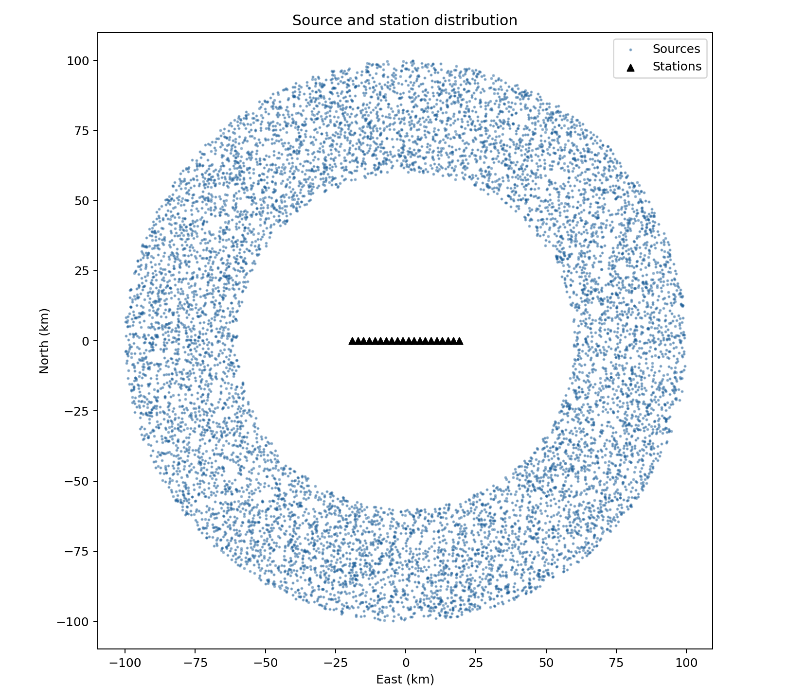
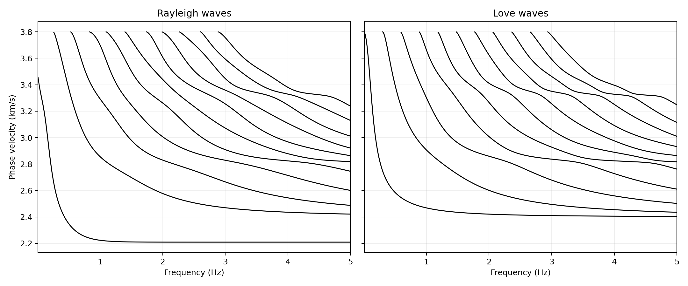
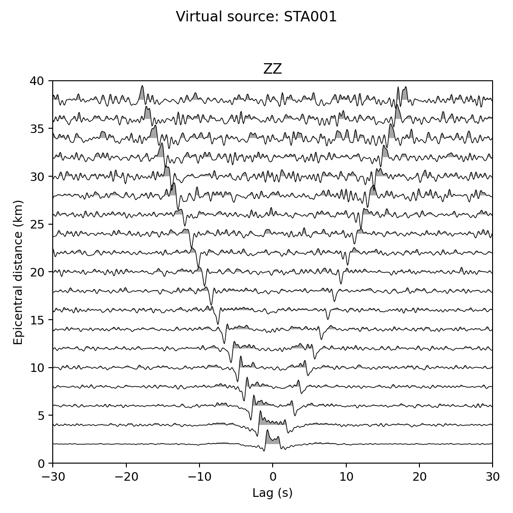
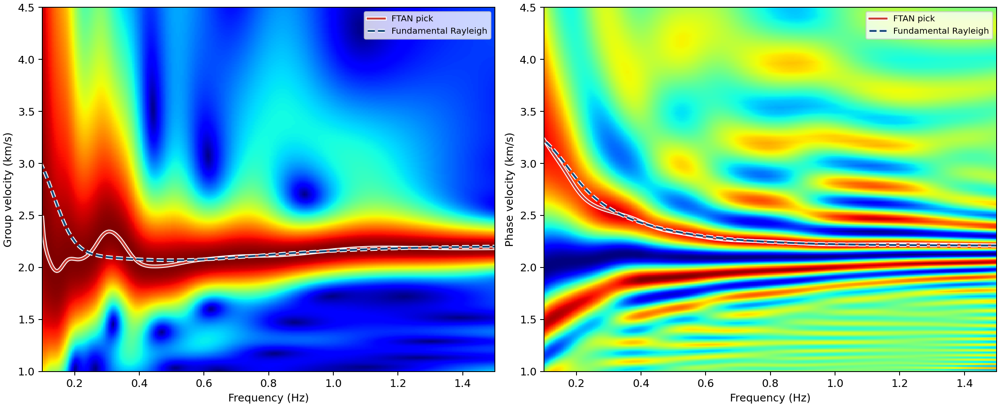

:author: 朱邓达
:date: 2026-11-04

(25) 基于面波的背景噪声模拟
------------------------------------------------

下载示例： :download:`ex25.tar.gz`

本例使用 :doc:`/Module/synnoise` 模块，叠加随机单力源激发的 Rayleigh 和 Love 面波，
为 20 个台站合成 ZNE 三分量背景噪声速度记录。
下面展示本例的输入、合成参数和结果，完整用法见 :doc:`/Module/synnoise` 模块文档。

模型与源台分布
========================

示例采用的层状模型如下：

.. literalinclude:: model4
    :language: text

示例采用的 20 个台站均位于地表，沿东西向等间距布设，间距为 2 km，总长为 38 km，台阵中点为坐标原点。
以该点为圆心，在半径 60–100 km 的圆环内按面积均匀抽取 10000 个地表源。

输入文件与合成参数
========================

震源文件的前几行如下：

.. literalinclude:: sources.txt
    :language: text
    :lines: 1-10

文件顶部的一些信息定义了对随机单力源的参数设置。

台站文件的前几行如下：

.. literalinclude:: stations.txt
    :language: text
    :lines: 1-7

文件顶部的一些信息定义了采样间隔为 **0.1 s**，记录长度为 **10 小时**。

合成命令如下，均使用第 0–10 阶模态：

.. tabs::

    .. group-tab:: CLI

        相关参数用法详见 :doc:`/Module/synnoise` 模块。

        .. literalinclude:: run_synnoise.sh
            :language: bash
            :start-after: BEGIN SYNNOISE
            :end-before: END SYNNOISE

    .. group-tab:: Python

        相关参数用法详见 :meth:`synnoise() <pygrt.pymod.PyModel1D.synnoise>` 函数。

        .. literalinclude:: 02_simulate_ambient_noise.py
            :language: python
            :start-after: BEGIN
            :end-before: END

每个台站的 ZNE 三分量记录保存为 ``ambient_run/noise/{staID}/[ZNE].sac``。

合成结果
========================

输出目录中会保存模型的相速度频散结果，下图展示了本次合成所使用的频散曲线。

另外，示例中也提供了 **计算背景噪声互相关的简易版脚本** ，用于验证背景噪声的结果。
下图展示了其中一个虚拟源的 **ZZ** 互相关结果，可见随台间距变化的相干面波信号。

示例中也提供了一个 **FTAN（Frequency-Time Analysis，频率–时间分析）的简易版脚本**，
用于进行群速度和相速度拾取，下图展示了其中一条互相关的处理结果。

而在实际数据处理中，拾取频散还需要加入一些频散追踪的技巧，以及考虑远场条件（例如取台间距大于两倍波长）和各种质量控制。

参考文献
========================

+ Bensen, G. D., Ritzwoller, M. H., Barmin, M. P., Levshin, A. L., Lin, F.,
  Moschetti, M. P., Shapiro, N. M., and Yang, Y. (2007).
  Processing seismic ambient noise data to obtain reliable broad-band surface wave dispersion measurements.
  Geophysical Journal International, 169(3), 1239–1260.
  doi: `10.1111/j.1365-246X.2007.03374.x <https://doi.org/10.1111/j.1365-246X.2007.03374.x>`_

+ Levshin, A. L., and Ritzwoller, M. H. (2001).
  Automated Detection, Extraction, and Measurement of Regional Surface Waves.
  Pure and Applied Geophysics, 158(8), 1531–1545.
  doi: `10.1007/PL00001233 <https://doi.org/10.1007/PL00001233>`_
