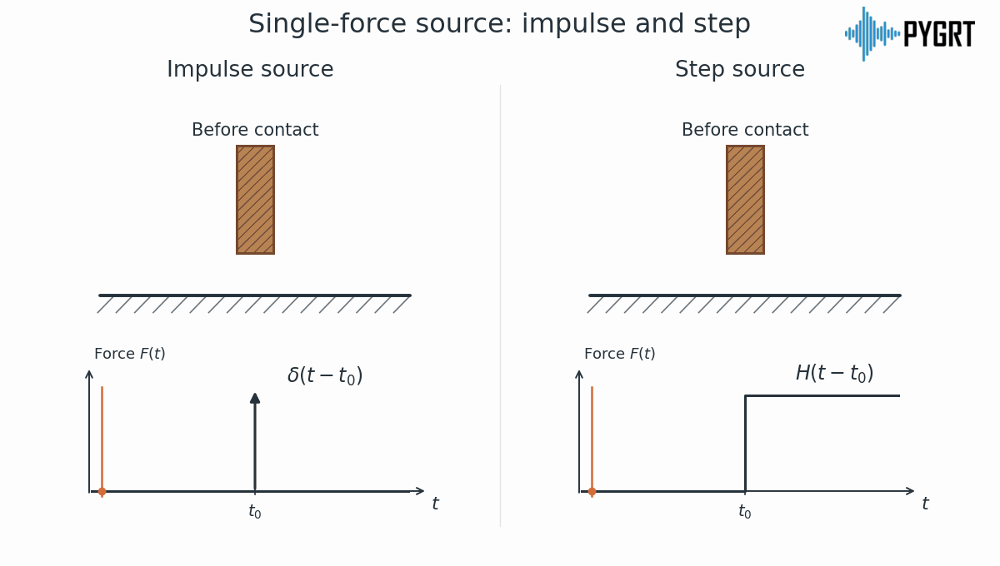
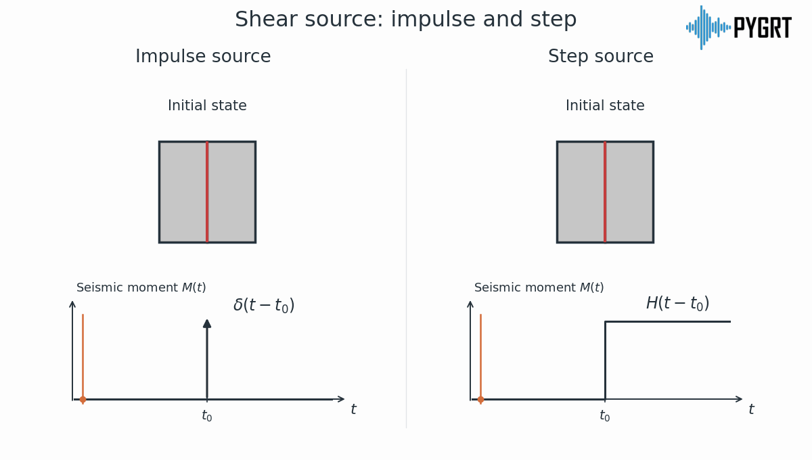

:author: 朱邓达
:date: 2026-10-14

位移还是速度？
========================================

判断合成结果是位移还是速度，需要同时明确 **震源时间历史和输出物理量**，
不能只看是否使用了积分、微分选项。

格林函数与合成
------------------------

固定模型、源台位置和震源机制，对一个分量有

.. math::

    u(t) = G(t) * S(t)
         = \int_{-\infty}^{\infty} G(t-\tau) S(\tau)\,d\tau

其中，:math:`G(t)` 是脉冲源的位移响应核，:math:`S(t)` 是包含强度的震源时间历史，
:math:`*` 表示卷积。对单力源，:math:`S(t)` 是力；对矩张量源，它是地震矩。
**合成就是将震源在不同时刻产生的响应叠加起来**。

:doc:`/Module/greenfn` 模块计算基本源型的脉冲响应，
:doc:`/Module/syn` 模块再加入震源机制、强度和时间函数，具体公式见 :doc:`../syn/syn`。
默认时间函数为 :math:`\delta(t)`，此时 :math:`G * \delta = G`，保留脉冲响应的波形。

积分、微分可以移到震源项
----------------------------------------

取震源作用前响应为零、积分常数为零，有

.. math::

    \frac{du}{dt}
        &= G * \frac{dS}{dt} \\
    \int_{-\infty}^{t} u(\tau)\,d\tau
        &= G * \left[\int_{-\infty}^{t} S(\tau)\,d\tau\right]

因此，**合成波形的时间积分、微分，可以等效地移到震源项上**：
保持同一震源，位移微分得到速度；将算子归入震源项，则是在构造另一种震源的位移响应。
后一种解释需要按新震源重新确定源强及其单位，不能忽略量纲变化。

脉冲源与阶跃源
------------------------

这里的脉冲函数和阶跃函数可以直观理解为两种 **理想化模板**：
单位脉冲 :math:`\delta(t)` 表示瞬时作用，单位阶跃 :math:`H(t)` 表示作用后持续保持。
实际锤击、滑动和破裂都有持续时间，还需要用 **具体的时间函数** 描述其过程。
由于

.. math::

    \int_{-\infty}^{t} \delta(\tau)\,d\tau = H(t),
    \qquad \frac{dH}{dt} = \delta(t)

**将脉冲响应积分一次，就得到阶跃源响应**。
“脉冲”和“阶跃”描述震源的时间历史。

下面动图左列为脉冲源，右列为阶跃源，下方显示 **震源时间历史**。

    单力源：脉冲源只在 :math:`t_0` 瞬时施力，阶跃源从 :math:`t_0` 起持续施力。
    下方信号表示力 :math:`F(t)`。

例如，向地面锤击可近似为 **脉冲型单力源**；
滑坡造成的局部持续卸载或加载，可近似为 **阶跃型单力源**。
滑动过程中的动态力仍需根据实际过程确定，而非理想阶跃。

    剪切源：脉冲源短暂错动后恢复原位，阶跃源发生错动后保留相对错位。
    固定断层面积和剪切模量时，地震矩与滑动量成正比。
    下方信号表示地震矩 :math:`M(t)`。

根据弹性回跳原理，天然地震释放积累的弹性应变，断层滑动后保留永久错位，
因此通常近似为 **阶跃型断层错动**，实际破裂则具有有限的上升时间。

在 PyGRT 中如何选择
------------------------------

**-D** （Python 的 ``time_function``）指定参与卷积的时间函数 :math:`\varphi(t)`，
其参数决定持续时间和波形形状。将它与两种模板卷积，有

.. math::

    \delta * \varphi = \varphi,
    \qquad H * \varphi = \int_{-\infty}^{t} \varphi(\tau)\,d\tau

以面积归一化的有限时长脉冲 :math:`\varphi(t)` 为例，不积分时，震源项保留其脉冲形状；
积分一次，则对应逐步建立、随后保持的阶跃过程。
**-D 设定卷积函数，源强和积分／微分设置共同决定完整的震源项** :math:`S(t)`。

例如，**-Dc/0.5/1.5** （``time_function="c/0.5/1.5"``）给出上升 0.5 s、下降 1.5 s 的余弦脉冲。
若用于描述阶跃型断层错动，它的累计积分表示在 2 s 内逐步建立、随后保持的滑动过程。

以最终地震矩为 :math:`M_0` 的地震为例，将 **-S** （``scale``）设为 :math:`M_0`，
并将 :math:`M_0\varphi(t)` 定义为 **矩率** :math:`\dot M_0(t)`，其时间积分才是地震矩。
同一震源的位移和速度为

.. math::

    u(t) = M_0 G * H * \varphi,
    \qquad v(t) = M_0 G * \varphi

因此，该震源 **积分一次得到位移，不积分得到速度**。
参数详情见 :doc:`/Module/syn` 模块和 :meth:`syn() <pygrt.pymod.PyModel1D.syn>`。

综上，**用户需要根据实际过程选择震源时间函数和源强单位，并对所采用的震源负责**，
再判断输出是位移、速度还是加速度。
