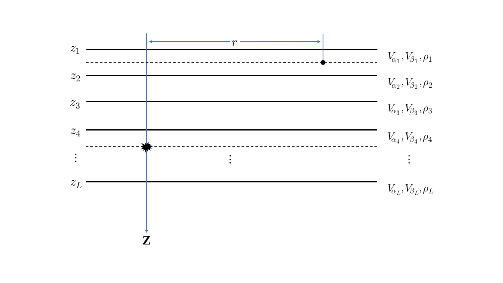

:author: 朱邓达
:date: 2025-04-17

准备工作
=============

**PyGRT** 程序包由 C 和 Python 两个编程语言的代码组成，目的是兼并高效性和便捷性。
底层复杂运算由 C 语言编写，并以可执行文件 :command:`grt` 的形式提供。
Python 接口主要负责组织模型与输出路径，并调用 :command:`grt` 完成计算与文件读写。

除了 Python 脚本式运行，也可直接在终端运行 :command:`grt` 。
受 |GMT| 的启发， :command:`grt` 程序对多个计算功能使用模块化管理，
可使用类似于以下格式来运行程序。每个模块可使用 ``-h`` 查看帮助。

.. code-block:: C

    grt <module-name> [<module-options>]

:command:`grt` **命令的运行独立于 Python，不需要 Python 环境，从而满足了更多计算场景。**

建立模型文件
--------------------

   一维层状模型示意图， :math:`z_S` 为震源层， :math:`z_R` 为接收层

这里的选项卡 **CLI** 代表使用 :command:`grt` 命令。后续的选项卡沿用此设定，不再解释。

.. tabs:: 

    .. tab:: CLI

        **PyGRT** 以如下自由格式定义模型中每层的物性参数，每列之间以空格隔开
        （最后两列的 Qp, Qs 可省略，即表示不考虑衰减）。
        当前程序仅动态全波解、接收函数支持衰减，其他模块会忽略这两列。

        .. code-block:: text

            Thickness(km)    Vp(km/s)    Vs(km/s)   Rho(g/cm^3)   [Qp]   [Qs]

        
        例如 :file:`milrow` 模型（假设文本文件名为 `milrow` ）

        .. literalinclude:: dynamic/gfunc/milrow
            :language: text
        

    .. tab:: Python

        模型格式与 C 一致。Python 端通过 ``modelpath=`` 传入模型文件路径
        （计算格林函数时还需同时指定 ``grn=`` 或 ``stgrn=``）。

        .. literalinclude:: dynamic/gfunc/run.py
            :language: python
            :start-after: START BUILD MODEL
            :end-before: END BUILD MODEL

.. note::

    最后一行表示半空间，对应厚度值不会被使用。

.. note::

    Vs 设置为 0 表示该层为液体层。

.. _finite-fault-file:

建立有限断层文件
--------------------

当你已经初步了解了 **PyGRT** 计算点源的用法后，你可以开始了解如何向程序传入 **有限断层**。

**PyGRT** 使用 |sCoulomb| (*simplified Coulomb*) 格式描述有限断层：
在 `Coulomb 程序 <https://pubs.usgs.gov/of/2011/1060/>`_ 完整输入文件中，
**只保留其中的断层部分，不包含其他部分的信息。**
因此如果已有完整的 Coulomb 输入文件，只需提取其中的断层表头和数据即可。
同一格式既可描述震源断层，也可描述接收断层，CLI 和 Python 均通过文件路径传入。

为方便浏览文档，以下快速介绍一下 |sCoulomb| 格式。

表头与数据列
~~~~~~~~~~~~~~~~~~~~

文件前两行为表头，随后每行一条断层记录，各列以空白分隔。
第一行以 **#** 开头，其后给出 10 个数据列标签；第二行为占位表头。
每条记录包含 11 个数值列：

.. code-block:: text

    #    X-start  Y-start  X-fin  Y-fin  Kode  value1  value2  dip  top  bot
    ---  -------  -------  -----  -----  ----  ------  ------  ---  ---  ---
    1    0.0      0.0      0.0    2.0    100   0.0     1.0     60   1.0  3.0

* 第 1 列为占位符，全部填 **1** 即可，不参与计算
* 第 2～5 列为断层顶边的起点 **(X-start, Y-start)** 和终点 **(X-fin, Y-fin)**，单位为 km
* 第 6 列 *Kode* 决定震源类型，第 7、8 列 *value1*、*value2* 的含义见下表
* 第 9 列 *dip* 为倾角，单位为 °；表头也可写成 **dip angle**，数据仍只占一列
* 第 10、11 列 *top*、*bot* 为断层顶深、底深，单位为 km

**X 为东向，Y 为北向，深度向下为正，所有震源和接收位置共用一个水平原点。**
注意静态合成与 :doc:`/Module/okada` 的网格选项 **-X/-Y** 分别为北向、东向，
与这里的断层文件的 X/Y 命名相反。

顶边起点指向终点定义正走向，两点不能重合，断层向走向的右侧下倾。
倾角须在 (0, 90]° 内，底深大于顶深；点源记录也须满足这些几何要求。

震源类型与滑动量
~~~~~~~~~~~~~~~~~~~~

**Kode** 列的值将决定对应断层纪录中第 7、8 列的含义：

.. list-table:: 分量格式中第 7、8 列的含义
    :header-rows: 1
    :widths: 10 30 25 25 10

    * - Kode
      - 震源类型
      - value1
      - value2
      - 单位
    * - 100
      - 矩形剪切断层
      - 右旋滑动
      - 逆冲滑动
      - m
    * - 200
      - 矩形剪切/张裂断层
      - 右旋滑动
      - 张裂开度
      - m
    * - 300
      - 矩形张裂/剪切断层
      - 张裂开度
      - 逆冲滑动
      - m
    * - 400
      - 断层面中心的点双力偶源
      - 右旋滑动矩势
      - 逆冲滑动矩势
      - m\ :sup:`3`
    * - 500
      - 断层面中心的点张裂/膨胀源
      - 张裂矩势
      - 膨胀矩势
      - m\ :sup:`3`

剪切滑动量允许为负，负值表示沿相反方向滑动。

另外，也可采用 **滑动角/总滑动量** 格式，仅支持 **Kode=100**：
**此时第一行第 7 列标签须精确写为小写 rake**，第 7、8 列则分别为滑动角 (°) 和总滑动量 (m)。
滑动角须在 [-180, 180]° 内，0° 为左旋、±180° 为右旋、90° 为逆冲、−90° 为正断层滑动。
例如，上面的逆冲断层也可写成：

.. code-block:: text

    #    X-start  Y-start  X-fin  Y-fin  Kode  rake  net-slip  dip  top  bot
    ---  -------  -------  -----  -----  ----  ----  --------  ---  ---  ---
    1    0.0      0.0      0.0    2.0    100   90.0  1.0       60   1.0  3.0

除首行开头的 **#** 和第 7 列的 **rake** 标识外，表头文字不决定各列的含义；
数据列仍须按上述固定顺序填写。
文件后缀不参与格式判断；通常分量格式用 *.inp*，滑动角/总滑动量格式用 *.inr*。

作为接收断层时，仅支持 **Kode=100**，滑动量不参与位移计算，
但几何和滑动角会随结果保存，供后续应力投影使用。
分量格式的滑动角由右旋、逆冲分量确定，两者均为零时未定义；
若只需指定接收滑动角，可使用 **rake** 格式并将总滑动量设为零。
未定义滑动角时，须在后续应力投影中补充。

逐行时间函数（动态合成）
~~~~~~~~~~~~~~~~~~~~~~~~~~~~~~~~

用于 :doc:`/Module/syn` 或 :doc:`/Module/lamb` 时，
可在每条记录末尾追加一个完整的 **-D** 选项，语法见相应模块的 **-D** 说明。
例如，以下三条逆冲断层分别使用不同的非对称余弦时间函数，延迟依次为 0、1.5、3.0 s：

.. code-block:: text

    #    X-start  Y-start  X-fin  Y-fin  Kode  rake  net-slip  dip  top  bot
    ---  -------  -------  -----  -----  ----  ----  --------  ---  ---  ---
    1    0.0      0.0      0.0    2.0    100   90.0  1.0       60   1.0  3.0  -Dc/1.5/2.5+d0.0
    1    0.0      2.0      0.0    4.0    100   90.0  0.8       60   1.0  3.0  -Dc/1.0/2.0+d1.5
    1    0.0      4.0      0.0    6.0    100   90.0  1.2       60   1.0  3.0  -Dc/0.5/1.5+d3.0

* 同一条记录剖分出的所有子源共享该时间函数和延迟；
  如需不同破裂延迟，可先用 :doc:`/Module/faultdiv` 生成逐行子断层文件
* 未设置全局 **-D** 或 Python 参数 *time_function* 时，所有记录须全部设置或全部省略时间函数，
  全部省略时使用脉冲；时间函数必须是行末最后一个字段，其后不要添加注释
* **-D0/file** 指定自定义时间函数时，相对路径以断层文件所在目录为基准
* 全局 **-D** 或 *time_function* 会统一覆盖文件中各行的时间函数和延迟；静态合成忽略这些字段
